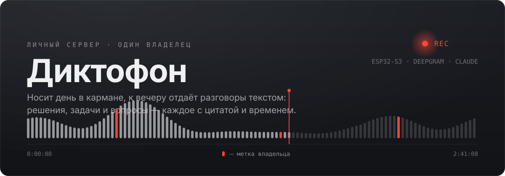
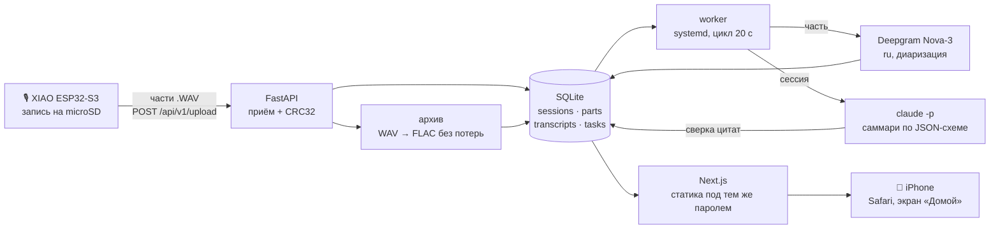

<p align="center">
  
</p>

<p align="center">
  <b>Носимый диктофон пишет рабочий день. Личный сервер превращает его в текст, задачи и вопросы — с цитатой и временем под каждым выводом.</b>
</p>

<p align="center">
  <code>ESP32-S3</code> · <code>FastAPI + SQLite</code> · <code>Deepgram Nova-3</code> · <code>claude -p</code> · <code>Next.js</code>
</p>

---

Диктофон на XIAO ESP32-S3 Sense пишет звук на microSD. После остановки записи он находит домашнюю Wi-Fi и отдаёт части файлов на личный сервер. Сервер хранит аудио, расшифровывает через Deepgram (ru, разделение говорящих), собирает саммари через `claude -p` и показывает результат в браузере iPhone.

Это не SaaS: один владелец, один сервер, ни регистрации, ни общего доступа. Ключи AI-провайдеров и весь архив остаются на своей машине.

## Что он делает

- **Разговор появляется сам.** Транскрипт, саммари, задачи и вопросы — без единого ручного действия, в том числе при заблокированном телефоне.
- **Каждый вывод модели показывает основание.** У решения, факта, задачи и вопроса есть метка времени и дословная цитата; сервер сверяет цитату с репликами рядом с этим временем. Совпала — кнопка ведёт к месту в аудио. Не совпала — пункт остаётся, но помечен «источник не подтверждён». Ничего не удаляется молча.
- **Задачи со сроком из живой речи.** «К пятнице», «через 3 дня», «23.09» становятся датой относительно дня разговора. Неоднозначное («как получится») датой не становится — уходит в спорные места.
- **Ручная правка сильнее автоматики.** Закрытая задача, имя говорящего, «ответ получен» переживают пересборку саммари после поздней части.
- **Поиск по-русски.** FTS5 по леммам: «сметы» находит «смету», «обсудили» — «обсудить».
- **Запись начинается раньше нажатия.** В покое микрофон слушает, а на карту ничего не пишется: звук течёт в кольцевой буфер на 30 секунд. Нажатие REC сохраняет и эти 30 секунд тоже — разговор, который стал важным только сейчас, остаётся с того места, где он ещё не был важным.
- **Метка кнопкой.** Короткое нажатие во время записи отмечает важный момент; метки приходят вместе с частью и попадают в саммари строкой «[метка владельца]».
- **Оригинал не теряется.** Запись важнее всего остального: отправка обрывается на середине, если нажата кнопка. Автоудаление на карте трогает только то, что сервер подтвердил.
- **Архив без потерь.** Принятый WAV переводится в FLAC, и совпадение не объявляется, а доказывается сверкой декодированного звука.
- **Волна — это измерение.** Огибающая громкости считается из самого файла при приёме части, а не рисуется для красоты.

## Как это работает



Очередь выведена из состояния строк в базе — отдельной таблицы заданий нет, поэтому зависших заданий не бывает. Транскрипт хранится по частям: поздно пришедшая часть не заставляет переплачивать за уже расшифрованное. Смещение части считается по размеру файла, поэтому шкала времени не зависит от ошибок Deepgram.

## Состояние

Проект честен о том, чего ещё не было. Ниже — проверенное, а не запланированное.

| | Что | Чем подтверждено |
| :-: | --- | --- |
| ✅ | Сервер: приём, очередь, транскрипт, саммари, задачи, вопросы, проекты, поиск, спорные места | 105 проверок: `python -m pytest server -q` и `bash tools/remote_tests.sh -q` (15 сентября 2026) |
| ✅ | Архив: принятый WAV переводится в FLAC без потерь, совпадение доказано сверкой декодированного звука | 5 проверок с настоящим ffmpeg на VPS |
| ✅ | Интерфейс: 10 экранов, тёмная тема по макету «Студия», статический экспорт | `web/`, аудит `docs/audit-2026-09-13-frontend.md` |
| ✅ | Развёртывание на VPS: две службы под systemd, сайт `https://esp-recorder.duckdns.org:8443` под паролем владельца | проверено запросами 13 сентября 2026 |
| ✅ | Deepgram вызван вживую на записи 34 с с двумя голосами | 13 сентября 2026; 4 слова из 39 ниже порога уверенности 0,7 |
| ✅ | Прошивка: кольцевой буфер, кнопка, границы частей, правила отправки, жизненный цикл записи с отказами карты | 2135 проверок на обычном компьютере, включая пропадание питания в каждый опасный момент: `bash tools/host_tests.sh` |
| ✅ | Автоматические проверки на каждый push: сервер с ffmpeg, хост-тесты прошивки (в том числе под ASan и UBSan), сборка прошивки, проверки и сборка сайта | `.github/workflows/ci.yml` |
| ⚠️ | Прошивка целиком: запись, предзапись, метки, отправка, индикация | собирается (32 % флеша), но на настоящей XIAO не запускалась ни разу |
| ⚠️ | Воспроизведение FLAC в Safari на iPhone | не проверено на устройстве |
| ⏳ | Отправка во время записи, шифрование карты, FLAC на самом диктофоне | ждут измерений на плате |
| ⏳ | Речевые метрики и расширенная память (этапы 3–4) | не начаты |

Что измерено не было и потому нигде не показывается как число: автономность, ёмкость батареи, ток, качество микрофона, стоимость минуты. Плата ожидается 2 октября 2026; план первого дня — [`docs/hardware-bring-up.md`](docs/hardware-bring-up.md).

## Быстрый старт

Нужны Python 3.10+ и Node 20+ (Node — только на машине сборки).

```bash
pip install -r server/requirements.txt
python tools/seed_demo.py                  # демо-база и аудио в demo-data/
cd web && npm ci && npm run build          # статика в web/out
cd .. && uvicorn server.app:app --port 8099
```

Открыть <http://127.0.0.1:8099>, вход `owner` / `demo`.

Обработку живых частей ведёт отдельный процесс:

```bash
python server/worker.py
```

Тесты:

```bash
python -m pytest server -q          # сервер; без ffmpeg 5 проверок архива пропускаются
bash tools/host_tests.sh            # чистая логика прошивки, платы не требует
```

## Устройство репозитория

| Каталог | Что внутри |
| --- | --- |
| `XiaoVoiceRecorder/` | Прошивка ESP32-S3: запись на microSD, выгрузка частей по Wi-Fi |
| `server/` | FastAPI, SQLite, воркер, клиент Deepgram, саммари через `claude -p`, отдача статики |
| `web/` | Next.js 16, статический экспорт, тёмная тема, 10 экранов |
| `shared/` | Контракты: `protocol.md` (диктофон ↔ сервер), `summary.schema.json` (модель ↔ сервер) |
| `tools/` | Демо-данные, сборка, деплой, подготовка VPS |
| `ui-mockups/` | Макет Claude Design «Студия» — визуальная константа продукта |
| `docs/` | Спеки этапов, планы, аудит интерфейса, план первого дня с платой, проектные решения |

Подробности сервера — в [`server/README_RU.md`](server/README_RU.md). Смысл продукта и его границы — в [`PRODUCT.md`](PRODUCT.md).

## Принципы

1. Измерение вместо утверждения: заряд, время, автономность и стоимость показываются только с источником или замером, иначе — «неизвестно».
2. Вывод модели без подтверждённой цитаты помечается, но не удаляется.
3. Ручная правка владельца сильнее автоматической пересборки.
4. Экран показывает только то, под что есть данные; декоративное не маскируется под измеренное.
5. Один владелец: никаких ролей, аккаунтов и следов многопользовательского продукта.

---

<p align="center">
  <sub>Личный проект одного владельца. Лицензия не назначена.</sub>
</p>
